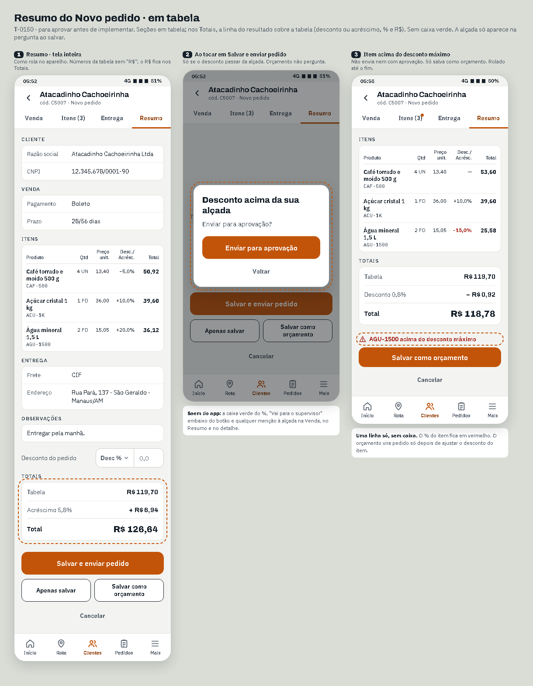
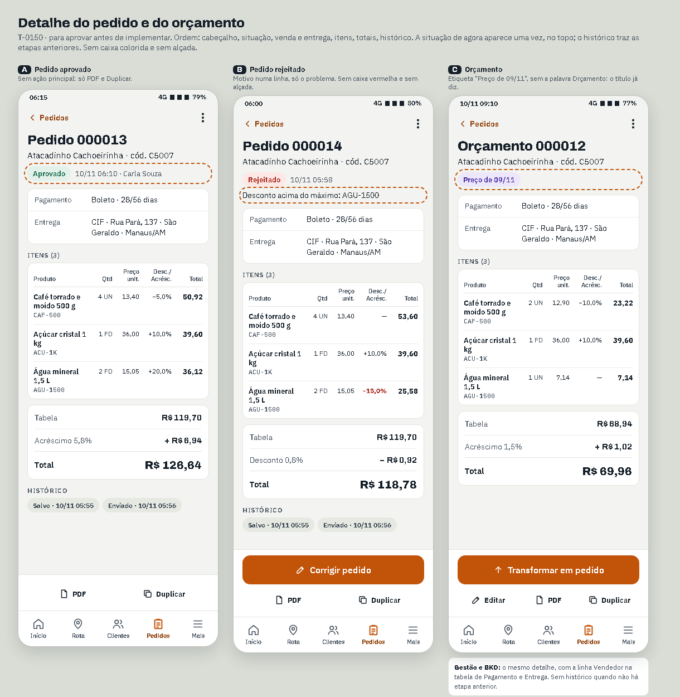
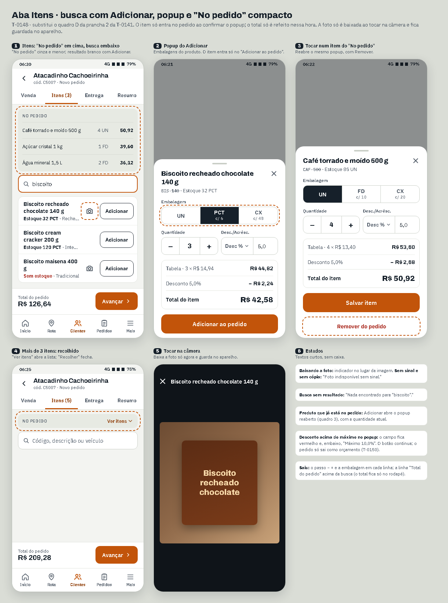
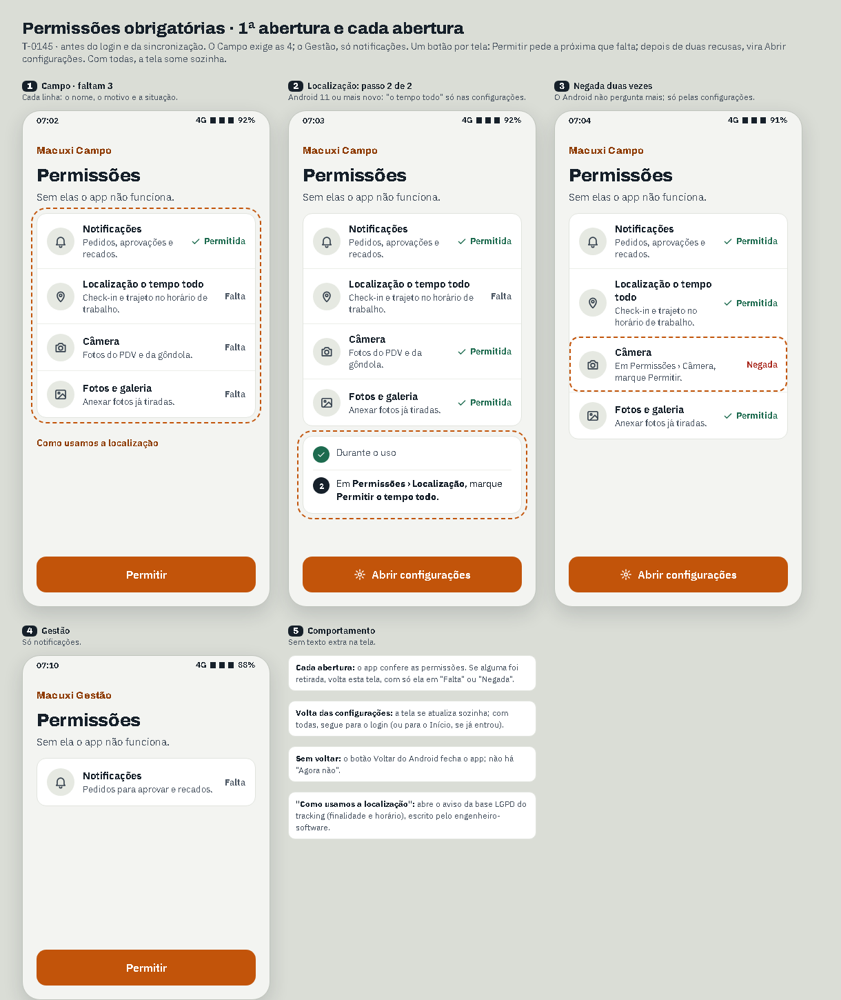
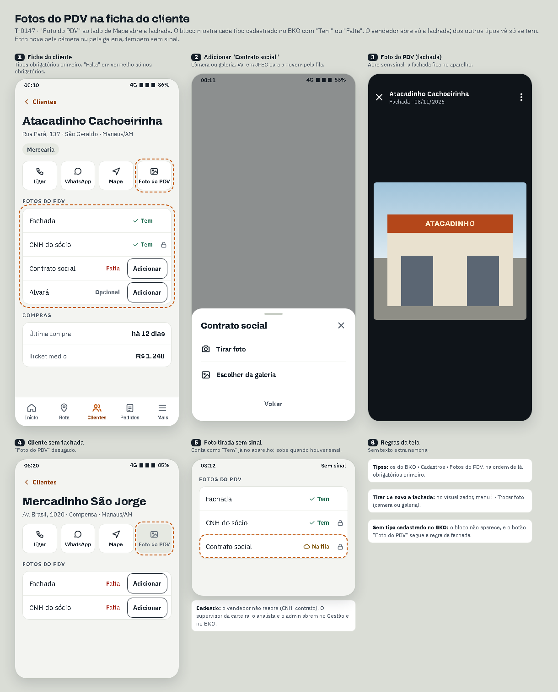
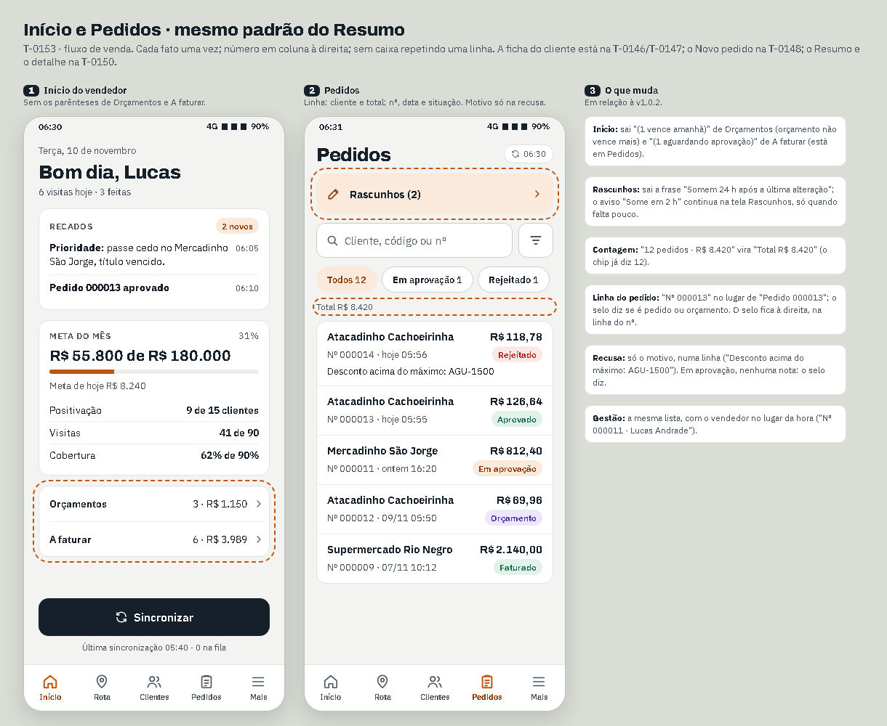

# As 6 imagens nos anexos para aprovar pelo celular (T-0150, T-0148, T-0145, T-0147, T-0153)

## Contexto
Resposta ao item 1 do R-20261110-085951. As imagens estão em `recados/anexos/`. De agora em diante, toda imagem para aprovação vai direto para lá, junto com o recado.

## O que preciso
Aprovar ou corrigir cada uma:

1. **Resumo do pedido em tabela (T-0150)**
   
   https://github.com/aloirr/macuxifdv-recados/blob/main/recados/anexos/2026-11-10-T-0150-resumo.png
2. **Detalhe do pedido/orçamento (T-0150)**
   
   https://github.com/aloirr/macuxifdv-recados/blob/main/recados/anexos/2026-11-10-T-0150-detalhe.png
3. **Aba Itens com Adicionar, popup de baixo e "No pedido" compacto (T-0148)**, já com o RD-0070 aplicado como o corretor propôs ("Ver itens" sem a contagem)
   
   https://github.com/aloirr/macuxifdv-recados/blob/main/recados/anexos/2026-11-10-T-0148-itens.png
4. **Permissões obrigatórias (T-0145)**
   
   https://github.com/aloirr/macuxifdv-recados/blob/main/recados/anexos/2026-11-10-T-0145-permissoes.png
5. **Fotos do PDV na ficha (T-0147)**
   
   https://github.com/aloirr/macuxifdv-recados/blob/main/recados/anexos/2026-11-10-T-0147-fotos-pdv.png
6. **Início e lista de Pedidos (T-0153)**
   
   https://github.com/aloirr/macuxifdv-recados/blob/main/recados/anexos/2026-11-10-T-0153-inicio-pedidos.png

Premissas que aparecem nas imagens:
- **Resumo:**
  - a seção Cliente traz razão social e CNPJ, porque o fantasia e o código já estão no cabeçalho;
  - com desconto acima do máximo, sobra só "Salvar como orçamento".
- **Detalhe:** a situação aparece uma vez, no topo, e o orçamento mostra só "Preço de 09/11".
- **Aba Itens:** o popup é uma folha que sobe de baixo, como as outras do app.
- **Fotos do PDV:** o botão diz "Foto do PDV", para caber ao lado de Ligar, WhatsApp e Mapa.
- **Permissões:** há um botão só, "Permitir", que pede a próxima permissão e vira "Abrir configurações" quando o Android para de perguntar.

## Pronto quando
Você responde "aprovo" ou o que corrigir, imagem por imagem. Com o ok, tudo entra na v1.0.4 de quarta.
