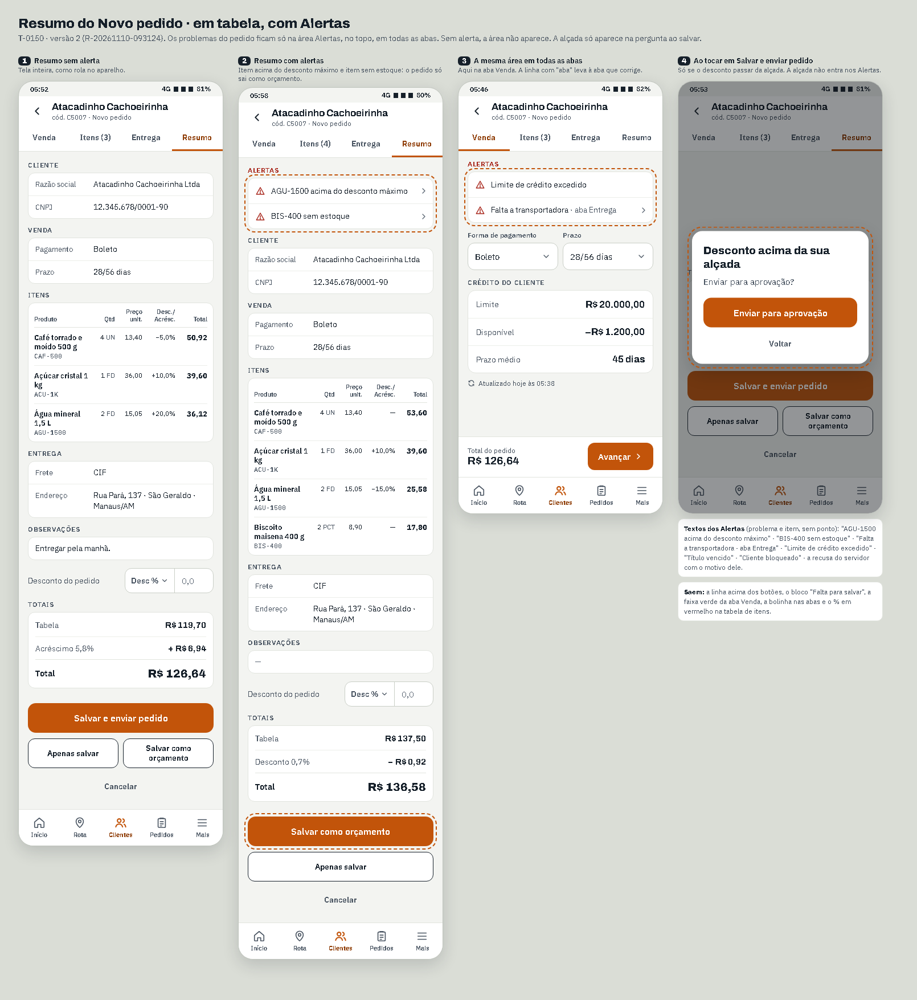
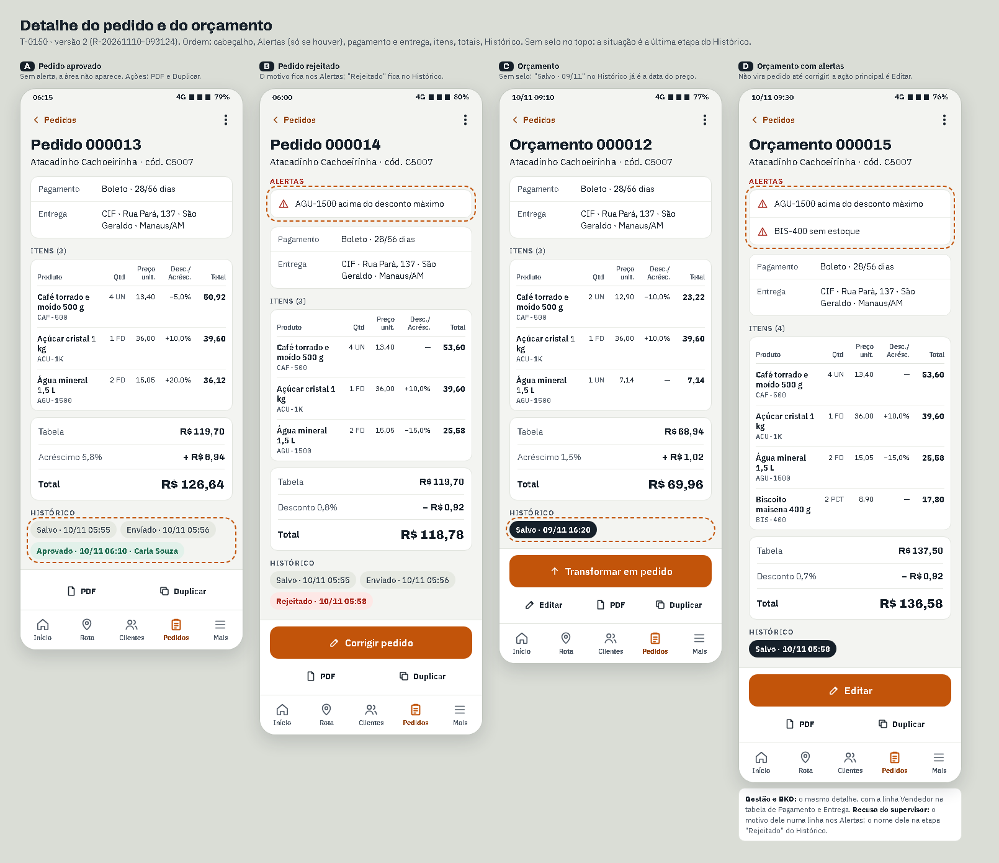
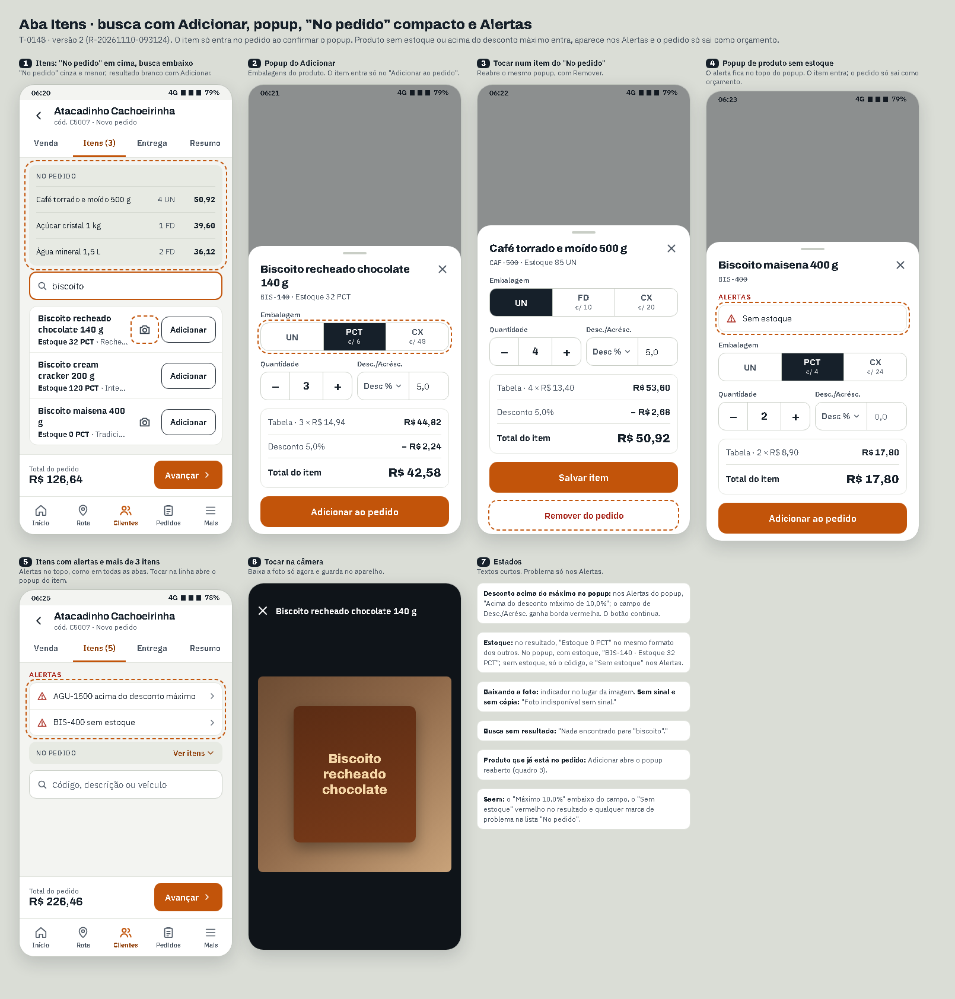

# Imagens v2 nos anexos (Resumo, detalhe e Itens com a área Alertas), liberadas pelo corretor; 5 premissas para confirmar

## Contexto
Versão 2 das imagens que você não aprovou de manhã (R-20261110-093124 e R-20261110-101343). Ela já traz:
- a área única **"Alertas"** no topo;
- a situação só no Histórico;
- nenhum aviso solto.

O corretor **liberou as 3 imagens** pela regra "uma informação, um lugar" (R-20261110-104230).

## O que preciso
Aprovar ou corrigir cada uma:

1. **Resumo do pedido (T-0150):** sem alerta, com alertas, com os Alertas na aba Venda e com a pergunta da alçada.
   
   https://github.com/aloirr/macuxifdv-recados/blob/main/recados/anexos/2026-11-10-v2-T-0150-resumo.png
2. **Detalhe do pedido/orçamento (T-0150):** aprovado, rejeitado, orçamento e orçamento com alertas. Sem selo no topo; a última etapa do Histórico é a situação.
   
   https://github.com/aloirr/macuxifdv-recados/blob/main/recados/anexos/2026-11-10-v2-T-0150-detalhe.png
3. **Aba Itens (T-0148):** Alertas no topo da aba e dentro do popup; o produto sem estoque entra.
   
   https://github.com/aloirr/macuxifdv-recados/blob/main/recados/anexos/2026-11-10-v2-T-0148-itens.png

**Premissas do designer que mudam decisões anteriores** (confirme ou recuse):
- **a)** Sai o selo roxo "Preço de 09/11" do orçamento. A etapa "Salvo" do Histórico já mostra a data do preço. Você tinha pedido o rótulo "preço de dd/mm" (RN-VEN-18).
- **b)** Sai a bolinha das abas do Novo pedido, porque cada linha dos Alertas já diz em que aba corrigir (muda a RN-CORE-36 dentro do pedido).
- **c)** Orçamento com alerta não mostra "Transformar"; a ação principal é Editar.
- **d)** Os Alertas aparecem em todas as abas do Novo pedido, e o Histórico aparece sempre.
- **e)** Com alerta de bloqueio, ficam "Salvar como orçamento" e "Apenas salvar"; "Salvar e enviar" sai.

## Pronto quando
Você responde "aprovo" ou o que corrigir. Com o ok hoje, as 3 telas entram na v1.0.4 de quarta. As correções de texto na tela atual já entram na v1.0.3 de hoje à noite.
