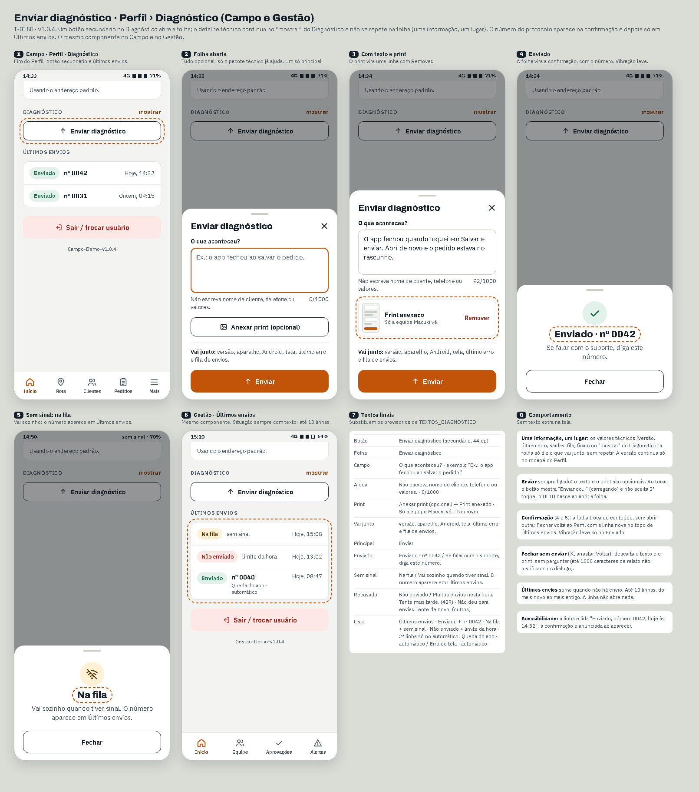
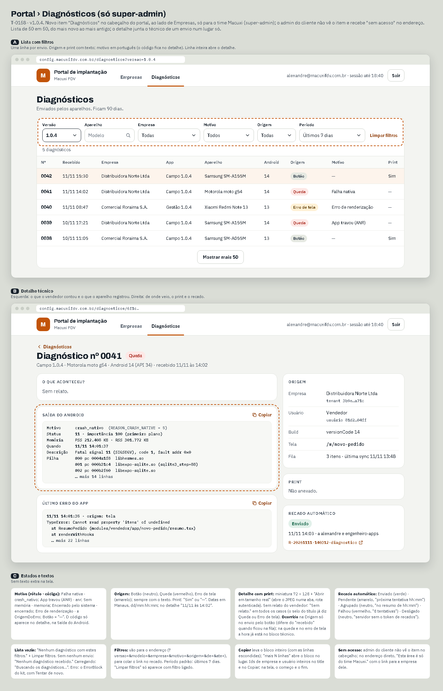

# T-0158: aprovar as imagens do Enviar diagnóstico (app) e do Portal › Diagnósticos

## Contexto
T-0158 (v1.0.4, quarta), do seu pedido R-20261110-101345: erros e quedas chegam à nossa nuvem. Seguem as duas imagens para aprovar. O corretor já deu o parecer, e os três achados dele (RD-0089, RD-0090 e RD-0091) já estão aplicados nas imagens e na spec: "Sem relato." em todos os casos, "Ocorrido" só no envio pelo botão e "fila de envios" no "Vai junto".

**1. App (Campo e Gestão): Perfil › Diagnóstico**

- No fim do Perfil, o botão secundário "Enviar diagnóstico" abre a folha. Nela ficam "O que aconteceu?" (até 1000 caracteres, com o aviso "Não escreva nome de cliente, telefone ou valores."), "Anexar print (opcional)" e o "Enviar".
- A folha diz só o que vai junto (versão, aparelho, Android, tela, último erro e fila de envios). Os valores técnicos continuam só no "mostrar" do Diagnóstico (uma informação, um lugar).
- Depois do toque, a folha vira a confirmação:
  - "Enviado · nº 0042" / "Se falar com o suporte, diga este número.";
  - ou "Na fila" / "Vai sozinho quando tiver sinal.".
- Embaixo do botão, "Últimos envios" mostra até 10 linhas: Enviado + nº, Na fila, Não enviado.

**2. Portal › Diagnósticos (só o time Macuxi)**

- O item "Diagnósticos" entra no cabeçalho do portal, ao lado de Empresas. O admin do cliente não vê o item.
- **Lista:** filtros de versão, aparelho, empresa, motivo, origem e período. Colunas: nº, recebido, empresa, app, aparelho, Android, origem, motivo e print.
- **Detalhe:** o relato do vendedor, a saída do Android e o último erro (com Copiar), a origem (empresa e usuário só por id), o print e a situação do recado automático.

## O que preciso
A sua aprovação das duas imagens, ou o que mudar (cite o número do quadro: 1 a 8 no app, A a C no portal).

## Pronto quando
Você aprovar a tempo do build da v1.0.4 (quarta). Com a aprovação, o engenheiro-apps aplica os textos e o visual.
