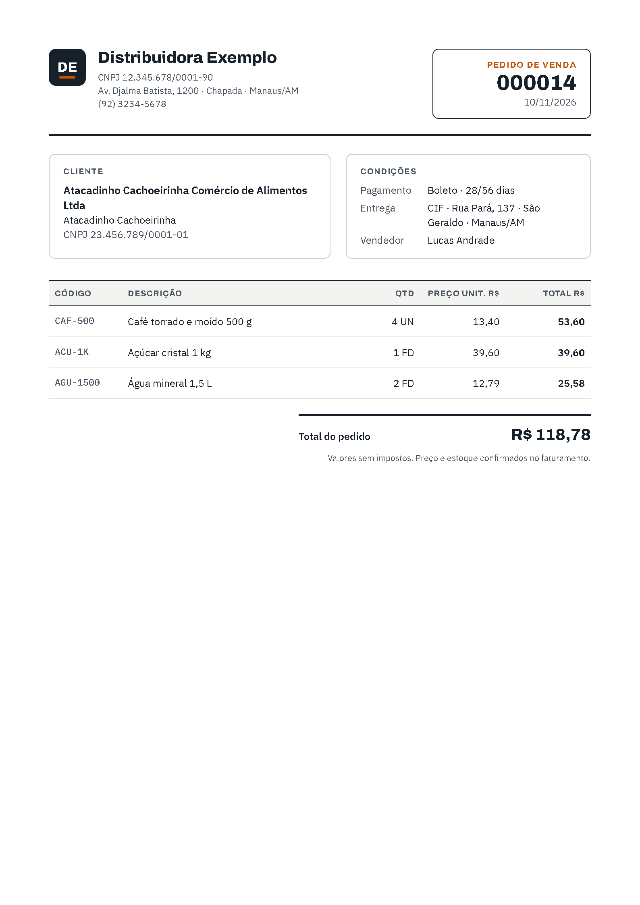
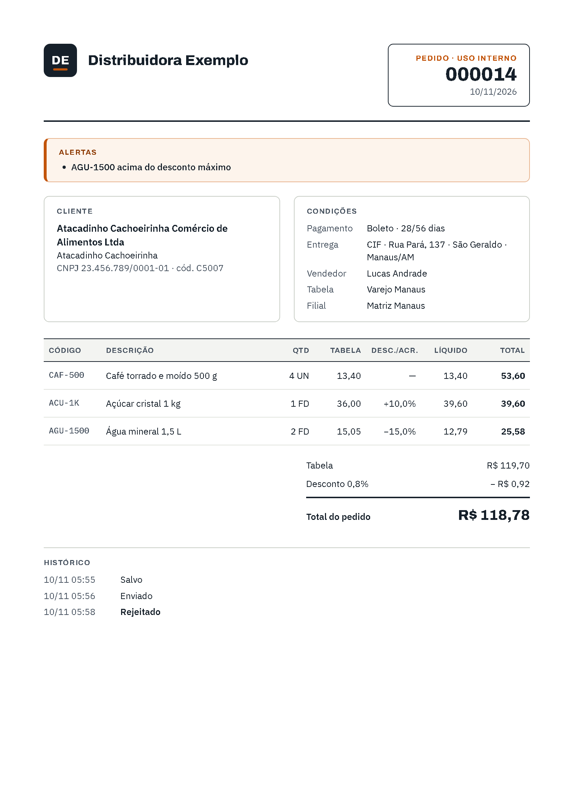
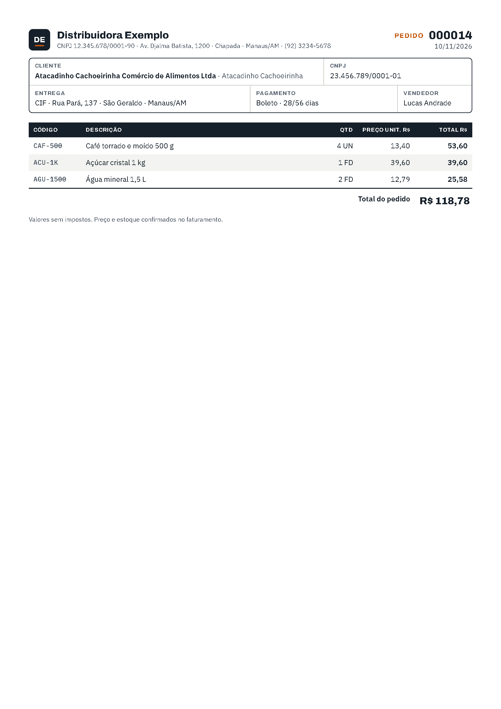
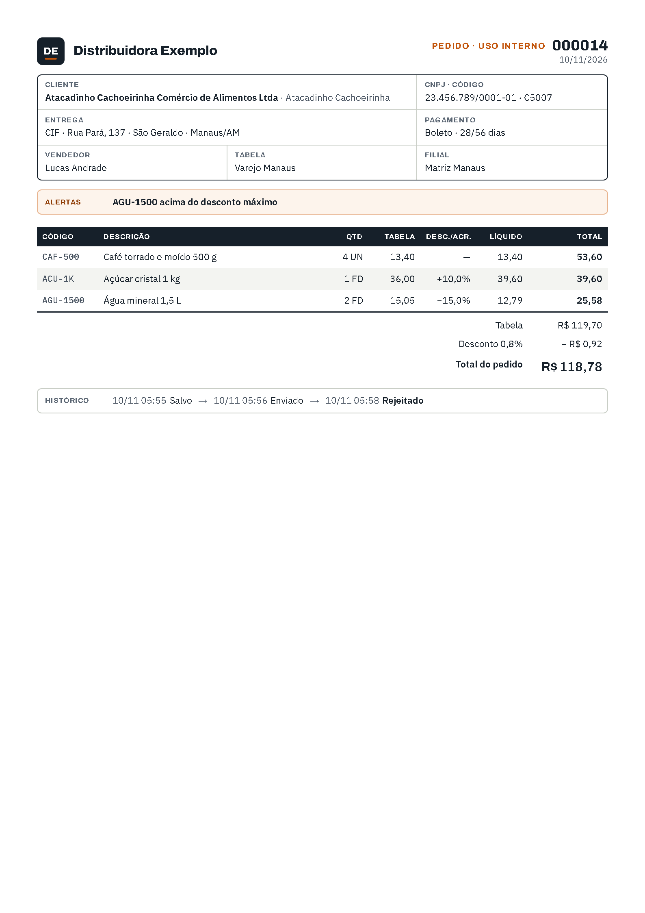
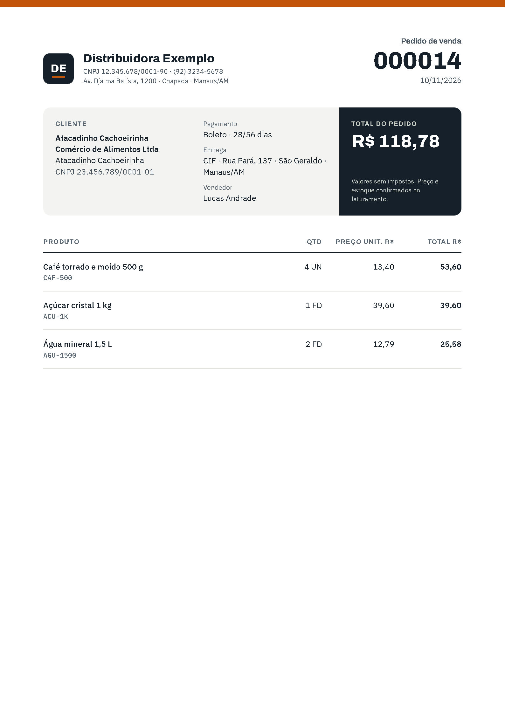
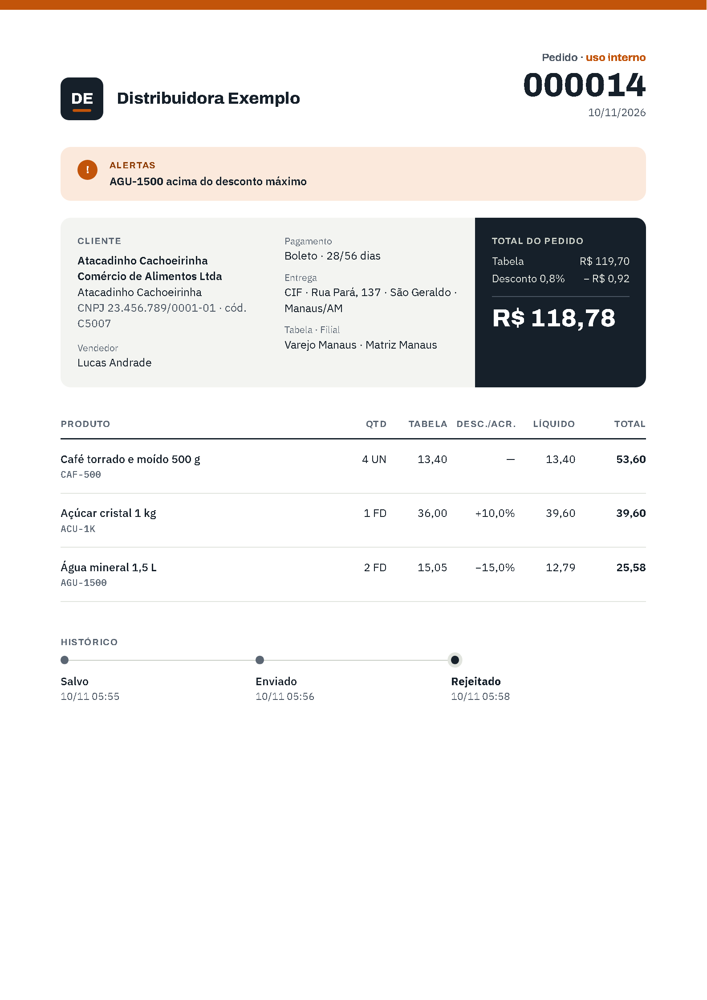

# T-0159: 3 propostas de PDF do pedido (cliente e escritório) para você escolher

## Contexto
Resposta aos pedidos R-20261110-192932 e R-20261110-202511 (T-0159). São 3 propostas, cada uma com a versão do cliente e a do escritório. As 6 usam o mesmo pedido: 000014, de 10/11/2026, com 3 itens; o mesmo do detalhe da T-0150. O arquivo sai como **PED-0014-10112026.pdf** (RN-VEN-41).

**Proposta 1: clássica.** Cartões Cliente e Condições, e o total embaixo, à direita.

**Proposta 2: compacta.** Os dados ficam numa grade, como na nota fiscal, e a tabela é densa. É a que põe mais itens em cada página.

**Proposta 3: moderna.** O total fica no topo, num painel junto de Cliente e Condições, e a tabela é arejada.

**Valem para as 3 propostas:**
- Cada informação aparece num lugar só:
  - vendedor, pagamento e entrega ficam em Condições;
  - a entrega é uma linha só, com o frete e o endereço;
  - a data fica só no cabeçalho;
  - o total aparece uma vez;
  - o desconto é uma linha só nos totais, com o % e o valor juntos (0,8% e − R$ 0,92).
- O frete aparece só como "CIF", sem "por conta da empresa".
- Na versão do escritório, os avisos ficam só em Alertas e a situação só no Histórico. A última etapa do Histórico é a situação atual, e a alçada não aparece.
- A versão do cliente continua sem nenhum % e sem a palavra desconto. Ela leva uma única nota, junto do total: "Valores sem impostos. Preço e estoque confirmados no faturamento."

**O que saiu da versão atual:**
- Cliente:
  - o vendedor e o prazo repetidos na linha do total e no rodapé;
  - o frete repetido no rodapé;
  - a data repetida no cartão;
  - o endereço do cadastro (fica só o de entrega);
  - "3 itens · 4 UN + 3 FD";
  - "Gerado pelo Macuxi FDV";
  - a segunda frase do rodapé, que agora está na nota junto do total.
- Escritório:
  - a linha "Desconto efetivo (sem frete)";
  - o % errado do desconto;
  - "Alçada do vendedor · dentro da alçada";
  - o selo de Status;
  - "Observação: Sem pendências.";
  - o motivo fora dos Alertas;
  - o endereço de entrega repetido;
  - "Gerado em … · uso interno · Gerado pelo";
  - "Valores sem impostos".

O parecer do corretor-redundancias (R-20261110-194932-designer-ux) ainda não chegou. Se ele tirar mais alguma coisa, mando em seguida. A spec está em docs/design/pdf-pedido-propostas.md.

## O que preciso
Que você escolha uma das propostas, 1, 2 ou 3, e diga o que quer mudar nela.

Os dados abaixo são de exemplo e ainda não existem no sistema. Eles entram no código depois da escolha:
- o logo "DE";
- o CNPJ, o endereço e o telefone da distribuidora.

## Pronto quando
Você responder com a proposta escolhida. O modulo-vendedor passa ela para o código, na v1.0.4 ou na v1.0.5.
