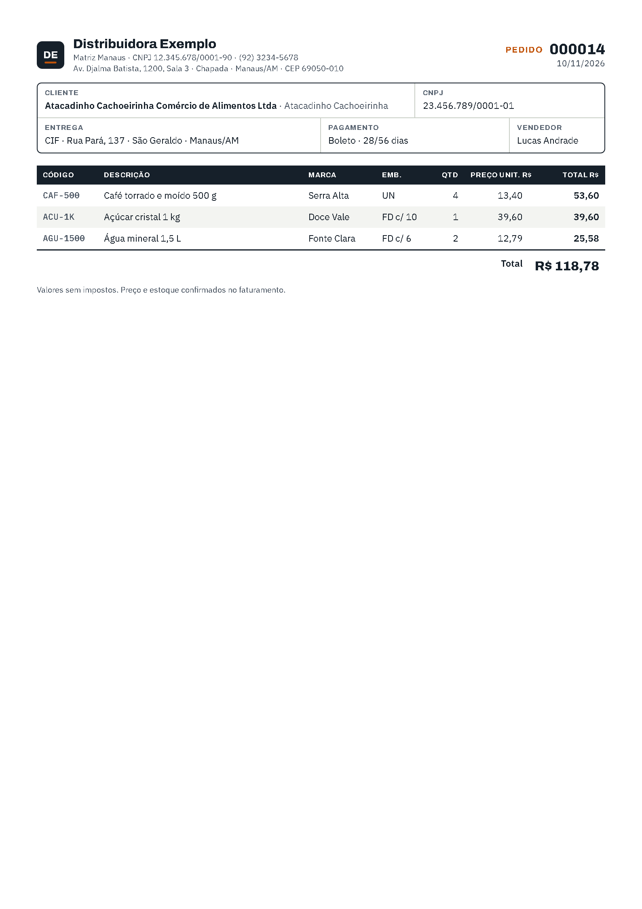
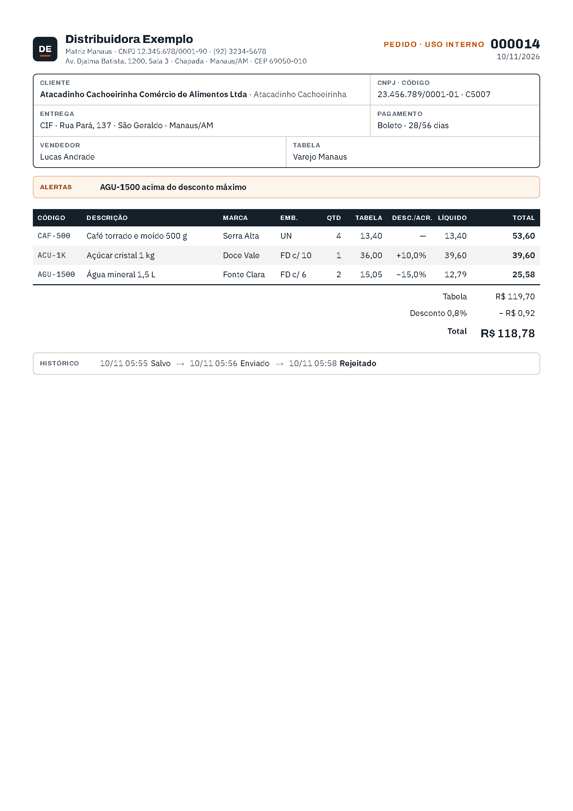
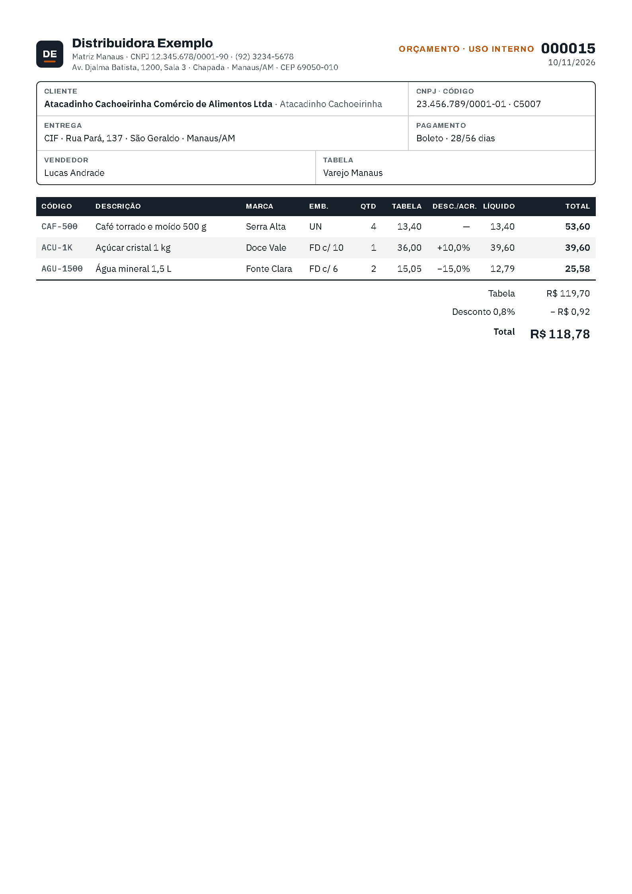

# PDF do pedido e do orçamento: 4 imagens finais para aprovar (Total e Histórico acertados)

## Contexto
PDF do pedido e do orçamento, proposta 2 que você aprovou (R-20261110-215816), com os 4 ajustes, a filial de faturamento no cabeçalho das 4 versões e os 3 acertos do corretor (R-20261110-233829, liberado no reteste). Entra na v1.0.4. Spec: docs/design/pdf-pedido.md.

## O que mudou desde a última imagem
- Rodapé dos totais: só "Total" (o cabeçalho já diz Pedido ou Orçamento).
- Histórico (versão do escritório): só sai com 2 etapas ou mais. Orçamento só salvo sai sem a faixa.

Pedido, versão do cliente:

Pedido, versão do escritório (com Alertas e Histórico):

Orçamento, versão do cliente:

Orçamento só salvo, versão do escritório (sem Alertas e sem Histórico):

## Pronto quando
Você aprovar as 4 imagens ou apontar o que muda. O modulo-vendedor implementa em modules/vendedor/domain/pdf-pedido.ts (pedido R-20261111-002805).
